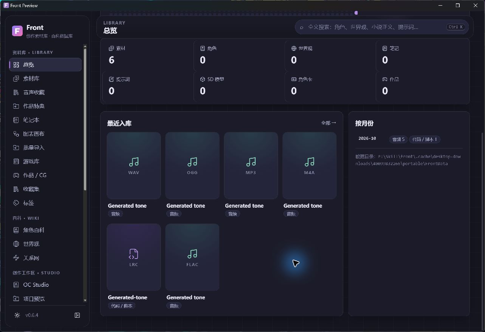

# Windows 桌面测试交付

Front 使用独立 Tauri 2 外壳加载同一份 Vue 生产构建，Python 业务通过 PyInstaller onedir 冻结为 Sidecar。Rust 直接管理资源目录中的可执行文件，不向 Vue 页面开放 Shell 或文件系统 IPC。打包输入只包含公共后端包、前端 dist、图标和依赖许可，不归档整个工作目录或用户资料。

## 当前交付状态（2026-10-24）

PR #25 音频、#26 特典、#27 模型资产均已通过 CI 并普通合并，稳定 Web 基线为 `176e59c`。PR #28 原生预览验收通过，待最终 CI 合并；它不代表 v0.7 正式发布。本机原生验收使用源提交 `e4228a8`、run `40099832266` 的测试包；最终CI以PR最新head为准。

| 验证范围 | 结果与边界 |
| --- | --- |
| 本机后端与前端 | 222 项后端测试通过，前端生产构建通过 |
| 源代码 Sidecar | 真实回环启动、认证、写入、退出、端口释放；Host/Origin/cookie/停止权限、数据锁、未来结构拒绝、迁移前完整备份和隔离恢复通过 |
| 源进程强制退出 | 隔离生成资料在已提交写入后强制终止，重启可读取，SQLite 完整性通过；不是断电测试 |
| Windows CI / 构建 | [run 40099832266](https://github.com/Fiesty-Abyss/Front/actions/runs/40099832266) 成功；221项通过、1项跳过，Tauri原生程序、NSIS、便携ZIP和SHA256附件已生成，不是正式Release |
| 冻结后端 | Windows runner 上真实 HTTP 冒烟通过；本次完整过程约 4.096 秒，包含启动、认证、写入与退出，不是窗口启动时间 |
| 本机原生窗口与音频 | 真实Front.exe/冻结后端运行，默认FrontData初始化、WebView缓存位于该目录；新建专辑并原地索引5个音轨和LRC，实际播放/顺播，SQLite保存5音轨播放状态。未授权API为401，既有Web版保持200 |
| 正常退出与重启 | Alt+F4后外壳、后端和原端口关闭；1专辑/6素材保留，SQLite完整性通过。重启窗口实际显示6素材，回环服务热启动就绪约1.79秒（200ms采样，非首屏绘制时间） |
| 外壳异常退出 | 仅强制终止已核对路径的外壳，Job Object使所属后端及端口在0.97秒轮询观察内关闭；1专辑/6素材保留，完整性通过、外键问题0，既有Web版仍正常 |
| 下载与包内容 | artifact及各文件SHA256已校验；已包含Python312.dll/vcruntime140.dll，权重文件0，不依赖本机Python/Node/Rust |
| 安装器安装/卸载/升级 | 已构建，干净系统安装与升级矩阵尚未验证 |

首次打包发现上游文件早于 1980 年的时间戳导致 ZIP 失败，失败轮未上传测试包。现已使用 ZIP 时间戳兼容模式并增加保留源字节和源时间戳的回归测试；重新构建的测试附件约 65.9 MiB。每轮构建记录以对应 Actions run 和最终提交为准。CI未输出跳过原因；仓库唯一显式skip条件为缺少FFmpeg时跳过视频探测生成样本，本机该项已通过。

## 生命周期和访问边界

- 后端预绑定 `127.0.0.1` 随机空闲端口并保留 socket，不争用 Web 版 8000 端口。启动完成后通过私有 stdout 管道发送端口、PID 和随机令牌，外壳校验所属进程。
- 引导 URL 的令牌仅在 fragment，立即清除并换取 HttpOnly、SameSite=Strict cookie。业务及静态请求均需认证，Host 和 Origin 须匹配本实例。令牌不写配置、日志或 localStorage。
- 正常退出使用仅外壳令牌可调用的停止接口，等待最多 8 秒后只终止自有子进程。Windows Job Object 用于外壳异常退出时清理所属 Sidecar；不按进程名终止其他 Python、Web 或 AI 服务。本机正常关闭和强制终止外壳的所属进程清理均已验证。
- 数据目录锁防止两个桌面实例并发使用同一库。现有 Web 入口不共享此锁，不应给同时运行的 Web 和桌面实例配置同一目录。默认安装和便携资料均与已有 Web 数据分离。
- 安装模式使用标准用户目录，`Front.portable` 标记启用程序旁 `FrontData`，可通过 `FRONT_DATA_DIR` 覆盖。WebView 缓存和轮转生命周期日志也位于该目录。权限不足拒绝启动，不清空或重置资料库；真实只读磁盘/ACL 场景尚未验收。

截图仅含生成音频卡片和程序自身，不包含私人项目、第三方角色或其他窗口。

## 本机资源测量（原生预览）

测量环境为 Windows、已有 WebView2、1280×850 窗口，使用隔离生成资料。以下为短时采样，未完成长时间或大量素材回归，**尚未完成桌面整体内存预算验收**。

| 范围 | RSS / 工作集 | PrivateBytes |
| --- | --- | --- |
| 外壳初始进程 | 24.1 MiB | 4.6 MiB |
| 冻结Python后端 | 117.9 MiB | 100.8 MiB |
| 9个自有进程求和（含WebView/GPU） | 814.7 MiB | 634.7 MiB |
| 对照：既有Web旧后端单进程 | 99.3 MiB | 未在此表比较 |

RSS求和重复计算共享页，不等同实际物理内存总量；PrivateBytes是提交的私有内存口径，也不是驻留物理内存。5秒空闲CPU增量求和为0%（单核口径），不代表使用过程的峰值。GPU进程占主要开销，GPU专用显存尚未测量。不能以外壳24.1 MiB代替整个软件占用。WebView/GPU内存分析、整体预算、冷热启动和多次工作区切换须在正式版前继续优化验证。

## 升级与完整备份

启动前拒绝未知未来表/字段或损坏库。需要结构迁移时，先复用完整托管媒体备份，默认不复制外部原地索引文件；Hash 校验和独立目录恢复试迁移通过后，才运行共用 `create_all/upgrade`。缺失托管资源或备份验证失败时停止默认升级。

安装和升级不自定义删除个人资料。卸载器提供的数据删除选项属于用户明确选择；默认升级流程保留资料。便携目录中的 `FrontData` 仍需用户在移除整个目录前自行备份。

本轮稳定 Web 库已在完整备份及隔离恢复通过后更新：20 个托管文件、34 条外部引用，原业务行和 34 个原件 SHA256 不变，SQLite 完整性通过，外键问题和缺失字段均为 0。备份、恢复副本和详细路径报告只保存在私有目录，不属于安装包。

## 构建和许可

Windows Actions 先执行后端测试、前端生产构建及冻结 Sidecar 冒烟，再打包 NSIS 和便携 ZIP，生成 SHA256 清单后上传测试附件。失败时不上传损坏测试包，可单独保存依赖锁诊断。Cargo.lock随源码和附件保留，用于固定后续Rust依赖解析；本机没有安装 Rust/MSVC 编译环境。

构建工具来源核对：官方 Tauri CLI 2.12.4/Rust 包（MIT/Apache-2.0），官方 PyInstaller 6.22.3（GPL 及打包例外）归为 preferred，仅在项目或 CI 中安装，不全局安装或索取新凭据。依赖声明与可用许可文本随 `THIRD_PARTY_NOTICES.json`、`backend/licenses` 提供，正式公开发布前仍需审核。未携带 Live2D 专有 SDK 或第三方模型。

参考：[Tauri Sidecar](https://v2.tauri.app/develop/sidecar/)、[Windows 安装器](https://v2.tauri.app/distribute/windows-installer/)、[PyInstaller 许可](https://pyinstaller.org/en/stable/license.html)。

## 尚未完成

- 原生预览功能验收已通过，但回环热启动数据不能代替冷启动、首屏绘制或长期稳定性验收。
- 整体内存预算验收未完成，须分析WebView/GPU开销；长时、冷热启动、大量素材和重复切换回归仍待。
- 干净 Windows 安装/卸载/升级矩阵、真实只读磁盘与权限不足验证仍待。
- 当前启动握手等待上限为 120 秒；大型资料迁移的进度反馈、长任务启动等待与恢复体验需要继续完善。
- 安装器缺少 WebView2 时通过微软引导程序下载；便携版要求系统已有 WebView2，纯离线运行时包尚未提供。
- 外部链接和外部创作工具打开流程尚待原生环境验证。
- 没有代码签名、签名更新、Updater 或正式 Release。真实生图/AI 服务未调用，Live2D SDK/素材许可、Krita/数位板、小说语义分析及大型素材库计划继续保留。
