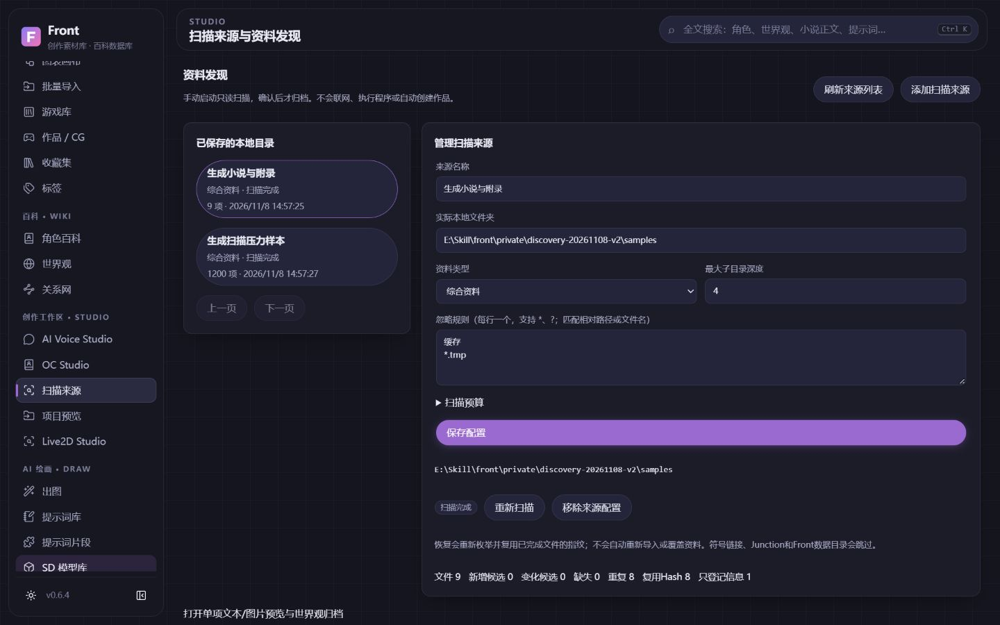
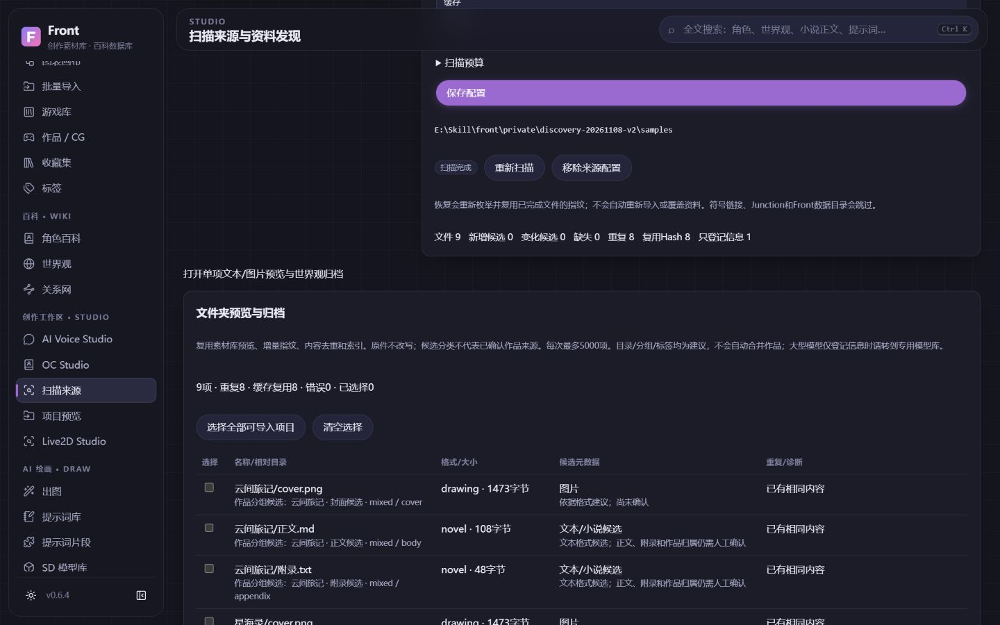
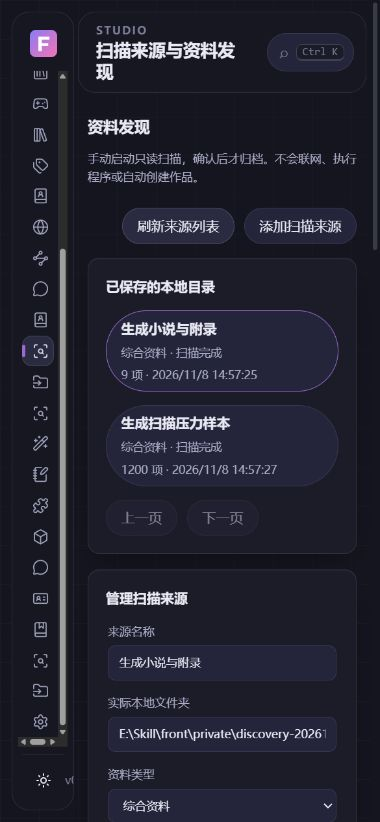

# 多根扫描与候选归档验收 · 2026-11-08

基线main3309eda，独立codex/discovery-roots分支。仅生成文件、虚构作品与独立资料库；未访问用户原创小说、模型或个人资料库，未升级用户安装、启AI服务、下载权重或接受许可。

## 可运行范围

持久化来源、稳定身份/并发保护、类型/深度/忽略/预算、显式扫描、暂停/取消/重新枚举续扫、增量指纹、完整范围的新增/变化/缺失报告；目录锚点和文件角色仅候选。新增discovery_roots一张表，复用ProjectPreview、LibraryImport、ProjectImport、Asset、ingest和jobs；无新依赖、文件库或常驻监控。

修复已有预览路径在resolve前未检查中间链接的问题，以及未Hash条目可进入通用导入的校验缺口。异常来源、排队失败、队列前取消、配置改变不能错误判缺失；重启不重放，旧预览不覆盖，移除配置不删除原件。全盘/数据目录/链接/Junction不作为根扫描。

## 实际浏览器（生成样本）

- 首根包含两部虚构作品、封面/正文/附录、ZIP和模型占位文件。忽略缓存后9项、Hash重复3、模型只登记1，扫描后Asset仍0；明确选择8项原地索引，最终5份共享素材。再次索引仍5份，10个原样本Hash保持，不复制权重、不自动建Work/角色。
- 第二根1200个生成TXT，键盘Enter保存1500文件预算。实际在81项暂停，继续复用81个已完成指纹并完成1200项；未确认的部分报告禁止导入。重启后两个来源、UID、配置、报告、素材引用均保留。
- 无效目录提交422，错误清晰且输入保留。两来源可切换，页面控制轮询仅跟随当前活动扫描，离开/切换停止界面轮询，不静默取消后台任务。
- 1440桌面、390窄屏深浅主题验收；窄屏document宽380，无横向溢出。canvas/audio均0，正常流程console warn/error0。临时尺寸已重置，未请求摄像头/麦克风。
- 失效自建空目录的来源/任务进度统一显示失败，具体诊断可见，不再显示完成；诊断后只清理该临时配置。
- 修正实际观察到的附录误作正文建议，补充较深目录“分类/作品/插图”锚点回归。生成内容/规则建议不等同AI理解或可靠的自动作品匹配。

## 自动化与兼容

新增专题覆盖多根/中文空格特殊字符、增量与内容去重、目录层级/忽略/数量/大小/条目/Hash预算、ZIP路径与展开预算、只登记模型、暂停续扫/排队前取消、429/503可重试、源失效、并发身份、整数边界、Hash读中增长、配置重启恢复、旧schema快照和完整备份独立恢复。Windows真实Junction已执行；本机不能创建symlink的场景明确跳过，CI按平台实际记录。没有用Mock冒充真实目录和Junction测试。

最终本机506后端通过/1权限跳过、15前端测试和生产构建通过；远程精确head/CI以本PR及NEXT_SESSION为准。一次本地构建重叠使旧测试3个静态目录夹具报错，已改为先构建后全量；该失败批次不作为验收结果，不将其归咎数据库损坏。既有TestClient弃用警告保留。

升级只增加配置表，既有前置SQLite快照/完整备份/恢复架构复用；隔离生成旧库验证旧world行保留，快照integrity=ok；完整备份恢复source UID/路径/报告且integrity=ok/外键0。未在原个人库执行DDL或自动迁移。

## 测量范围

同一本机、Windows11家庭版22631/Python3.13.9，生成文件暖缓存；真实API触发及20ms状态轮询包含在耗时中，不是冷启动或TTI。9项重扫0.0515秒、复用8Hash；1200项两次重扫1.4566/1.4273秒、复用1200Hash、实际Hash读取0；50项响应27230字节。测试与隔离pytest存在同时运行，不能视为严格前后对照。

自身源码后端单次工作集117.28MiB、PrivateBytes102.11MiB；不是全软件/WebView/GPU、峰值、长期泄漏或优化前后结论。扫描报告仍按每根上限整体读取后分页，不宣称十万文件索引或SQLite查询优化。

最终Discovery独立JS约11.30kB（gzip5.29kB），无Three/Live2D/音频初始化；构建体积不代替启动/Heap/GPU实测。未验证故障/网络盘硬超时、全量压缩包CRC/解码、真实语义作品边界、自动联网匹配、完整原生窗口交互。
