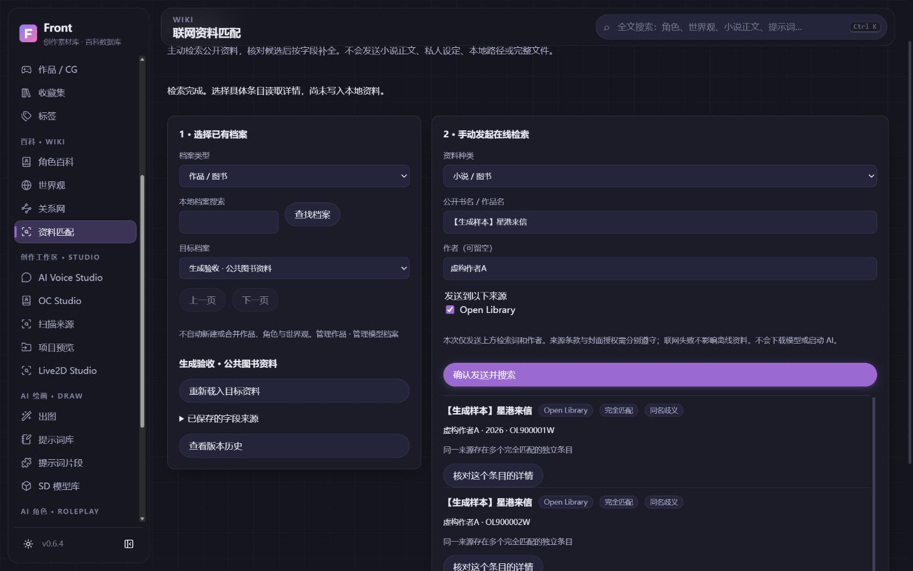
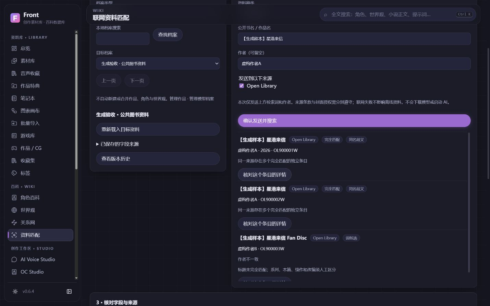
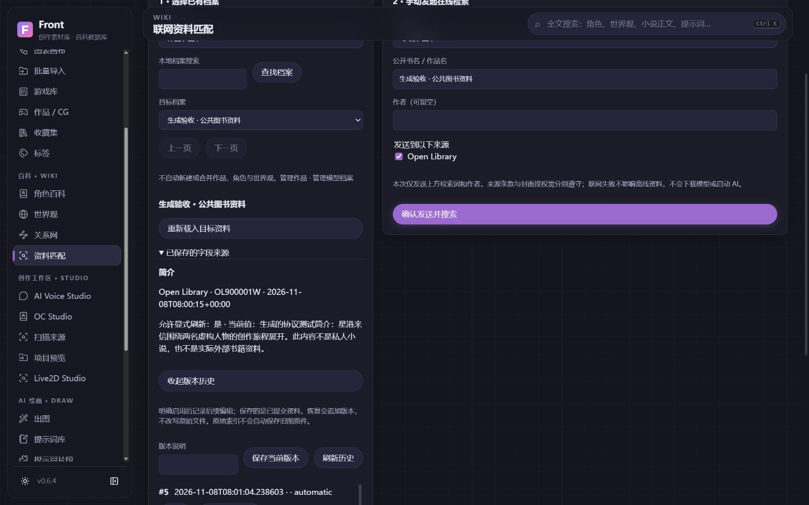
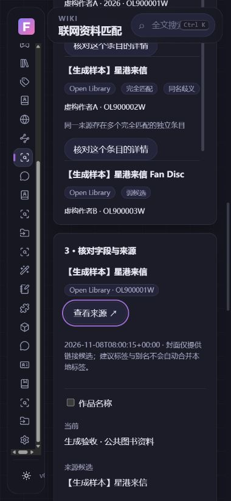
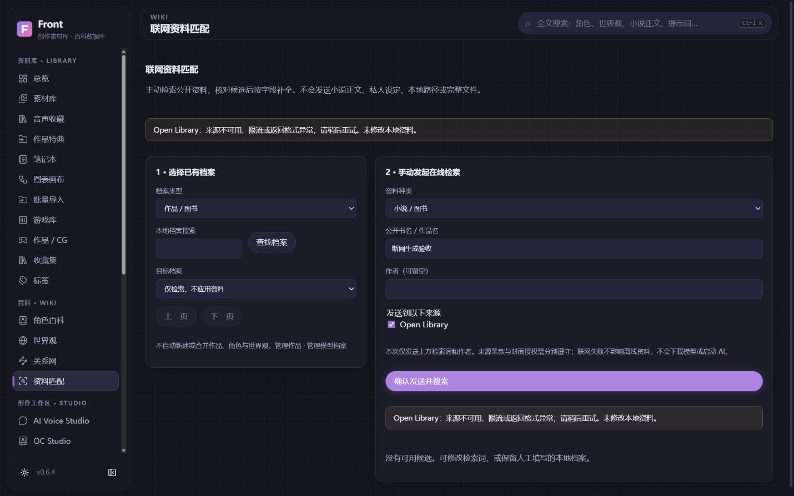

# 联网资料匹配验收 · 2026-11-08

基于 #62 合并 main `47054ea9bb471d4e346fbbb406b8d61bece7bcdd` 的独立 codex/metadata-center 分支。#62精确head f3bd6d28、常规42458154437与Windows42458154440全部成功，正常merge，无强推或公开Release。

## 证据与缺陷

旧 similarity 对长标题包含给0.9、auto_match门槛0.8，生成的“Generated Story / Generated Story Fan Disc”同年份即可错误补来源；quick-add还接受0.6。现改为保守精确身份与同源歧义拒绝。手动封面原无覆盖标记、刷新可重新下载替换；新增标记并回归保护。不是为了新页面重写整个资料库。

最终本机后端521通过/1权限跳过，156.89s，仍有原有TestClient弃用警告；专题27通过（含15新测试和12游戏回归）。前端15通过，生产构建6.09s。日志：工作区缓存 metadata-full-final、metadata-node-final、metadata-build-final；源码显式PYTHONPATH指向本工作树。构建与pytest顺序执行，不删除正在运行的测试所需dist。初次专题有2失败（测试会话工厂名写错、旧fixture依赖宽松标题），已修正工厂，并让精确身份回归使用真实完整示例名；另加非精确不匹配独立断言，没有恢复错误阈值。

覆盖：主动请求与参数限制、原始条目ID/Hash、同名/作者/年份/标点/FD误配、部分来源失败/密钥脱敏、队列饱和/取消、缓存与凭据被淘汰后重取、超大/非JSON/重定向响应、人工内容与人工清空保护、字段刷新权限、stale指纹/事务回滚/幂等、追加式版本恢复、游戏旧刷新与上传封面、旧列补齐/升级前快照/完整备份隔离恢复/完整性与外键。

## 真实公开服务与生成验证分开

- 真实 Open Library：用户可见输入只含公开书名 Pride and Prejudice 和作者 Jane Austen，实际 search + work详情成功；十候选含两个同名独立Work，页面显示歧义，FD/改编/合订本弱候选。GUI尝试替换生成本地简介遭409保护，单独来源链接应用成功。没有下载封面、小说全文、模型或私人数据；没有对其他来源开展真实服务验收。
- 随后仅自建隔离实例切换 httpx.MockTransport，返回“【生成样本】星港来信”等虚构元数据，所有截图来自此生成流程。不是在线图书事实或AI推理。真实Front页面/API/SQLite/jobs/版本仍实际运行。
- GUI完成：现有作品页新建生成档案、键盘选小说类型、进入匹配、检索词/作者Enter提交、同名/FD分级、详情焦点、冲突提示焦点、明确替换/允许刷新、恢复前预览与确认、历史3→4→5、取消、模拟断网提示、关闭自身实例并同目录重启、字段来源和五版本仍存在。
- 1440桌面、390窄屏深浅主题；窄屏document380/viewport390，无横向溢出；canvas/audio0，未初始化模型播放器/推理引擎。正常重启验收console warn/error0；主动409属于预期失败反馈。临时尺寸已重置。
- 自建实例保留2扫描根、5素材、1作品和5版本，十个扫描源生成文件前后SHA256一致。个人活动库、用户8000服务、原创项目、旧WebUI、Live2D和模型原件未触碰；测试进程只按专属标记/控制记录做认证停启。

## 性能与局限

同一生成协议/暖缓存两次Job含轮询0.0262/0.0259s，响应2131B；不是实际互联网延迟或AI性能。一次自身Python进程WS115.51MiB、PrivateBytes99.88MiB；不同时间/缓存/并发条件，不据此声称比A降低内存或完整桌面优化。没有Heap/GPU/冷启动/长时泄漏结论。

新懒加载Metadata脚本12.88kB（gzip6.00），样式1.53kB；初始主chunk216.92kB（gzip83.42），A基线216.71/83.34，约+0.21/+0.08kB。未新增依赖、模型权重或常驻推理。

Windows构建/冻结Sidecar/安装器与便携完整性由本PR适用CI验收，成功后才正常合并；不等于本机运行了新安装器、干净Windows升级、签名正式更新或发布。精确head/最终CI在PR与NEXT_SESSION后续记录。

未完成：ISBN/Edition/语言、动漫来源扩展、作者逐条详情、Google/NextMoe、统一模型写入历史、跨来源自动补全/单字段冲突UI增强、旧网络响应全面流式预算，以及C/D/E/F独立功能。各项继续在功能库保留。

## 生成截图

