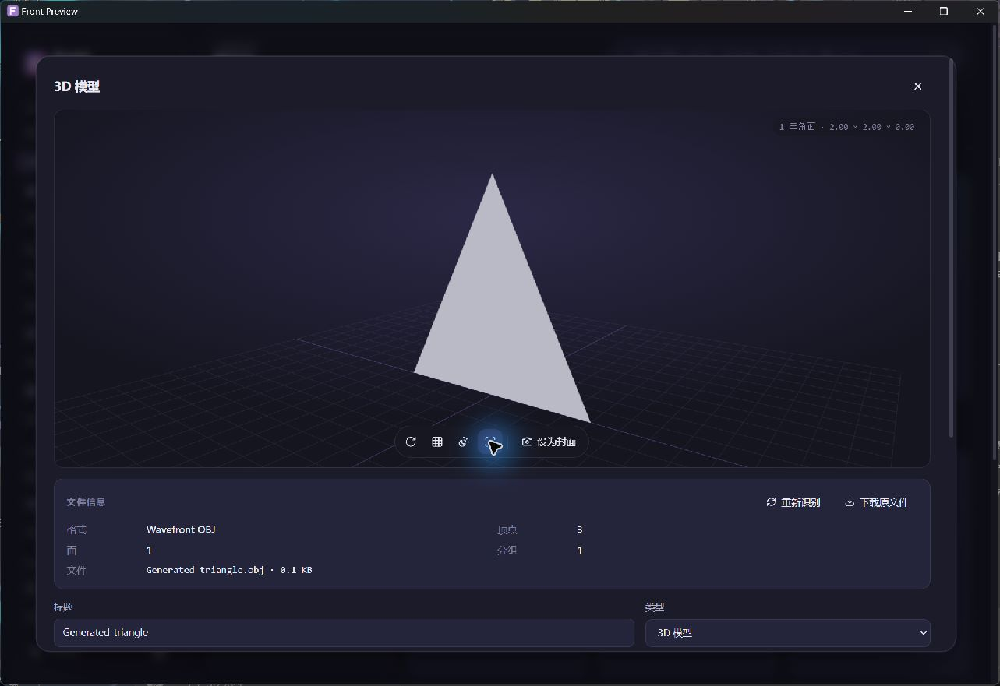

# 阶段A：桌面资源生命周期与性能前后对照

日期：2026-10-25。阶段开始基线为main `1508a5c`；本次对照包的原生壳和冻结后端来自已验收的 `e4228a8` 预览，候选使用同一原生壳/冻结后端并替换为本轮Vue生产构建。本文记录本机单组前后测量，不代表正式版的完整性能验收。

## 结果

普通非调试启动下，基线和候选各完成10次相同的原生三维预览打开/关闭。10次后的自有进程私有提交由基线1340.71MiB降至候选907.49MiB，本组终点采样低433.23MiB（32.31%）。从各自初始值计算，基线增长821.19MiB，候选增长389.21MiB，增长量减少52.60%。这些比例只描述本场景的单组数据，不是全软件通用节省比例、峰值或统计分布。

候选又追加20次，共累计30次，私有提交采样回落至685.75MiB。该样本显示本轮没有按打开次数线性累积，仍较候选初始值高167.48MiB；长期稳定性和复杂模型回归需要继续验证。

## 对照方法

- 使用两个独立的隔离数据/浏览器profile目录，均为相同7个生成素材（含同一单三角面OBJ），不读取、修改或压测正式用户库和原始素材。
- 基线和候选都使用普通原生启动、相同窗口和工作负载。通过原生CUA实际打开预览，确认三角面可见后点击关闭；两组各10次。候选追加20次仅作回收趋势观察，基线没有30次等量对照。
- 未强制GC。没有CSS视觉改版或以降低画质替代资源清理。每个角色和总量均来自对应自有进程树，未把其他用户应用或正式Web服务计入。
- 数据保存在忽略的本地审计缓存，本文只公开数值、采样文件名和脱敏方法，不公开用户目录、原始命令行、页面内容、认证令牌或私人资料。
- 原始指标文件：`baseline-warm-before.json`、`baseline-warm-after10.json`、`candidate-warm-before.json`、`candidate-warm-after10.json`、`candidate-warm-after30.json`。文件名的`warm`表示本次普通启动对照；`after30`是累计30次开关，不是静置30秒。

## 指标口径

`desktop/profiling.py`读取Windows进程内存和GPU进程计数。命令行仅在本机用于区分WebView子进程角色，导出只包含进程名/PID/角色和指标；工作集查询读取页元数据，不读取进程页内容。

- Working Set（WS/工作集）是该进程驻留页计数，按进程求和会重复计算共享页，不能称为整软件实际物理内存。
- Private Commit（私有提交）包含该进程承诺的私有内存，不等于私有驻留工作集，也不等于物理RAM。
- 私有常驻、可共享常驻与当前共享常驻来自独立的工作集页采样；与WS快照不是同一原子采样，二者相加可能与WS略有差异。本组五份样本的可共享常驻与当前共享常驻数值相同。
- 按ShareCount折算的常驻值只作估计，工具最多按7个共享方计数，更多共享方时会高估；它不是精确PSS，也不是物理总量。
- GPU dedicated/shared是Windows的进程GPU内存计数，单列记录，不与CPU工作集或私有提交相加；不是整张显卡的峰值或全局显存使用量。
- 查询失败或覆盖不全时，新采样器保留`null`和覆盖数，不用0冒充未测到。下面五份历史采样中每组9个进程的所列字段均有实际数据。

### 按角色拆分

单位MiB；每格格式为 **WS / 私有提交**。辅助进程包括conhost、crashpad和两个utility。

| 角色 | 基线初始 | 基线10次后 | 候选初始 | 候选10次后 | 候选累计30次后 |
| --- | --- | --- | --- | --- | --- |
| Tauri外壳 | 23.74 / 4.25 | 23.71 / 4.19 | 23.73 / 4.29 | 23.73 / 4.29 | 23.71 / 4.20 |
| 冻结Python后端 | 109.75 / 93.48 | 110.38 / 93.82 | 109.98 / 93.61 | 110.49 / 93.99 | 110.36 / 93.73 |
| WebView浏览器进程 | 126.99 / 43.08 | 128.30 / 43.87 | 125.53 / 42.07 | 126.51 / 42.56 | 128.30 / 43.89 |
| WebView页面Renderer | 94.18 / 51.02 | 109.53 / 58.79 | 97.35 / 53.86 | 114.36 / 64.08 | 112.85 / 61.91 |
| WebView GPU进程 | 255.94 / 299.43 | 1074.79 / 1111.79 | 258.68 / 296.07 | 652.88 / 673.97 | 439.66 / 453.50 |
| 辅助进程合计（4个） | 74.64 / 28.27 | 74.71 / 28.24 | 74.68 / 28.37 | 74.82 / 28.59 | 74.91 / 28.52 |

### 总量、驻留拆分和共享页

单位MiB。这里的“可共享常驻”也等于本组采样中的“当前共享常驻”。

| 采样 | WS求和 | 私有提交求和 | 私有常驻求和 | 可共享常驻求和 | 按ShareCount估计常驻 |
| --- | --- | --- | --- | --- | --- |
| 基线：打开前 | 685.25 | 519.53 | 385.65 | 299.07 | 428.38 |
| 基线：10次后 | 1521.43 | 1340.71 | 1211.56 | 309.34 | 1255.75 |
| 候选：打开前 | 689.96 | 518.27 | 391.30 | 298.14 | 433.90 |
| 候选：10次后 | 1102.79 | 907.49 | 795.39 | 306.89 | 839.23 |
| 候选：累计30次后 | 889.80 | 685.75 | 581.45 | 307.84 | 625.43 |

主要变化出现在WebView GPU进程；外壳和后端较稳定。页面Renderer的私有提交也有增长，因此不能把GPU进程回落理解为所有页面分配均已回到初始值。

### GPU独立计数

单位MiB。本组GPU计数均来自所属WebView GPU进程。

| 采样 | Dedicated Usage | Shared Usage |
| --- | --- | --- |
| 基线：打开前 | 93.95 | 107.02 |
| 基线：10次后 | 84.54 | 884.21 |
| 候选：打开前 | 82.67 | 103.96 |
| 候选：10次后 | 63.29 | 223.05 |
| 候选：累计30次后 | 82.16 | 235.55 |

候选累计30次后GPU shared仍高于初始值。浏览器/驱动的延迟回收和缓存行为与应用资源清理需要分层分析，以上采样不能单独证明没有长期泄漏。

## 启动和首屏：本轮尚无提升结论

候选首次使用新应用profile的一次诊断中，壳层mark约414.4ms、FCP约816ms，均相对页面导航时间原点。壳层mark只表示界面壳层挂载，未等待异步资料加载，不是完整首屏可交互或标准TTI。

该样本的进程启动epoch为1792856522264ms，页面timeOrigin为1792856524685ms，加FCP 816ms后，进程启动到FCP约3237ms。这只是单样本的**应用profile缓存冷、OS文件缓存暖**场景，不是真正机器/磁盘冷启动。

另一个基线诊断样本FCP为624ms，但来自不同轮次，不能与候选816ms组成有效启动性能改进结论。真正冷启动、热启动分布、同条件重复FCP/首屏可交互测量与标准TTI仍待补齐。上轮1.79秒回环服务就绪也不能代替这些指标。

曾尝试以远程调试方式重启测试进程采集诊断，该动作被自动审核拒绝后没有重试。最终等量对照改为普通非调试启动；上述过程不构成绕过审批或新的调试权限。

## 本轮代码改动及兼容性

- 所有工作区路由维持懒加载，未进入三维预览不创建WebGL场景。Live2D目前仍是档案能力，本轮没有初始化其未实现的实时渲染器或AI推理服务。
- ModelViewer卸载时终止可取消的加载；晚到的加载结果按生命周期状态立即释放，不继续建立已离开页面的预览。清理几何、材质的标准贴图/纹理uniform、ImageBitmap、骨骼，以及mixer/actions/root缓存。
- 清理renderer渲染列表、实例和WebGL上下文；页面隐藏或预览离开可见区域时暂停循环；错误状态停止RAF，避免空场景持续刷新。
- Dashboard、motion指令和Modal清理所属动画、RAF和观察/回调生命周期，避免卸载后启动晚到动画。
- 只增加只读诊断与前端生命周期修复，不改变用户数据库结构、不复制原模型、不新增常驻服务。原生壳/后端复用用于控制本次对照变量；新的安装/升级组合由阶段B继续验收。

## 实际验证与模拟边界

| 验证 | 结果与边界 |
| --- | --- |
| 原生OBJ预览 | 基线10次、候选10次等量开关，候选累计30次；每次由CUA确认生成三角面实际可见后关闭 |
| 真实封面抓取 | 候选OBJ封面成功，480×196、842种颜色，验证非空渲染及快照流程；不是复杂模型画质/兼容性证明 |
| 前端资源测试 | Node资源生命周期3项通过，使用模拟资源验证释放、ImageBitmap去重和晚到结果处理；不是实际VRM贴图或骨骼兼容测试 |
| 后端回归 | 加入telemetry前222项全量通过，新增telemetry3项专题通过；最终225项全量、生产构建与远程CI结果由交付记录核对 |
| 真实模型/原始工程 | 本轮没有使用私人模型或原创工程做压力测试；glTF贴图、VRM、骨骼/动画复杂场景尚未实测 |

截图仅为生成OBJ，不含第三方模型或用户原始素材。

## 复测步骤

1. 核对目标Commit、生产构建和预览包Hash；准备两个全新隔离目录，分别记录profile及应用数据状态。向两个目录导入同一组7个生成素材（含相同OBJ），不使用正式用户库。
2. 普通启动基线和候选，分别识别自有外壳进程树，记录窗口、WebView2/系统/硬件版本和相同初始页面。单独采样各自before，不凭总进程名混入其他WebView。
3. 通过原生交互各做10次打开、确认模型可见、关闭，确保两组等待和采样步骤一致，随后用`desktop/profiling.py <所属外壳PID> --output <隔离报告路径>`采样。命令中的PID和路径需使用本轮实际值。
4. 如需观察候选回收趋势，可追加到累计30次并记录；应另外为基线补等量30次，才能进行该轮同工作量比较。记录等待时间和采样误差，不主动强制GC来美化结果。
5. 校验原始JSON每项coverage；分角色、驻留共享、私有提交和GPU计数分别汇总。恢复为未知的字段不得填0，原始报告留私有目录，公开时仅脱敏结论与生成截图。
6. 分开进行冷/热和首屏可交互采样，重复足够轮次后报告分布；应用新profile、OS文件缓存和真实干净VM属于不同条件，不能互相替代。

## 阶段A剩余项

- 整体桌面内存预算和可接受阈值尚未验收；本轮候选10次后仍为907.49MiB私有提交，需继续定位WebView/驱动、页面分配和缓存开销。
- 需要更多独立重复、基线与候选等量30次、长时间运行及跨全部工作区的往返测试；不能从单组三角面数据推断长期零泄漏。
- 真正冷启动、热启动分布、异步数据完整首屏可交互、标准TTI和同条件CPU/帧率采样未完成。
- glTF贴图、VRM、复杂骨骼/mixer/动画，以及纹理解码的实际兼容性尚未验证。Node模拟资源测试不替代这些实物文件测试。
- 音频长时间播放/切换后的内存和媒体解码回收、图像大画廊和大量缩略图、小说与角色大型数据的heap/交互变化待阶段E及后续回归。
- 没有新增Live2D实时渲染、面捕或GPU模型推理；相关释放验收需待合法SDK和实际实现。设备差异、离线/干净系统安装和升级资料保留继续按阶段B矩阵推进。

## 最终候选补测

最终构建追加静态按需绘制：停止旋转的普通模型在 OrbitControls 阻尼结束后不再空转，视角/线框/动画/旋转/尺寸变化会重新绘制；VRM及实际动画保持需要的循环。相同原生预览与静止视角，5秒自有进程 CPU 单核等效采样从19.69%降至1.56%，短样本不能当作整机CPU占用或长期预算。没有降低纹理、抗锯齿或像素比。

最终本机后端225项通过（112.46秒），Node资源测试3项通过，生产构建通过。曾有一轮因测试与Vite清理dist重叠产生夹具错误，已以串行重跑结果替换，不把失败轮计为通过。Windows CI由PR最终结果另行记录。实际模型截图/封面使用生成OBJ；复杂带贴图GLB/VRM、动画和故障加载仍需扩大真实浏览器回归，资源单测不能替代此验收。
