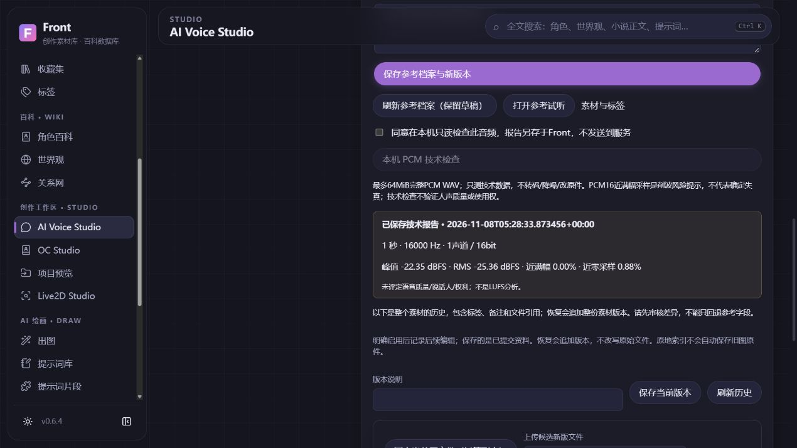
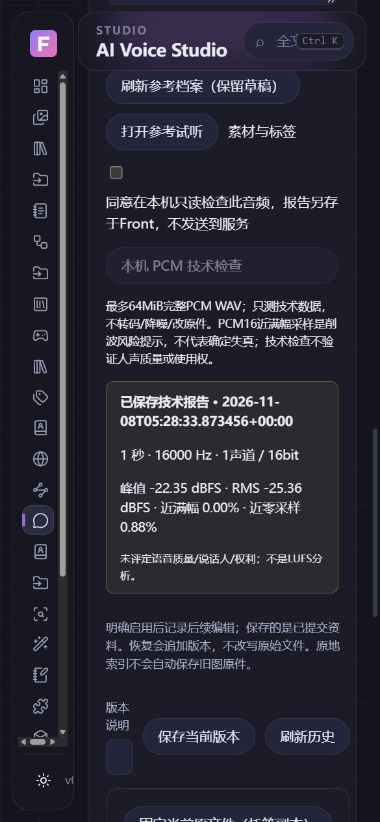

# Front 本轮验收与未完成范围 · 2026-11-08

这是生成样本、真实本机与协议模拟分开记录的验收，不是正式RC/发布批准。记录时功能main：`c1e5917e6128ef7bb7f1d84fea98195c943a2c45`（#60已合并）；本文档收尾合并SHA以GitHub为准。精确head和各阶段CI见[NEXT_SESSION](../../NEXT_SESSION.md)。

## 环境与原件

本机：Windows 11家庭中文版64位、10.0.22631；源码测试Python3.13.9、Node24.15.0。Windows Actions是远程构建环境，不是用户电脑或干净VM。开发使用独立工作树，未替换根checkout/用户安装。

个人库先保全DB/WAL/SHM三件副本，再由工作副本做SQLite一致性快照；没有在原件上执行SQLite打开、迁移或修复。快照integrity=ok、外键0，隔离升级读取旧数据、备份和独立恢复成功。旧程序读取新结构副本能复现笼统拒绝，但历史窗口的准确程序路径仍未知，不认定原件损坏。最后三件Hash与初始取证相同。

没有修改用户原始小说、模型、旧WebUI或第三方Live2D资源；没有上传私人素材/路径报告/密钥，没有接受SDK许可、装权重、启用收费API或发布Release。

## 独立交付

| PR | 已实现及证据 | 不包含的能力 |
| --- | --- | --- |
| #54 | 启动结构/损坏/锁/权限等分类、只读诊断；个人库副本实测 | 原件自动修复、准确历史包归因、个人安装升级 |
| #55 | 生成声线/OC/工程/拆并排序/双候选试听采纳/导出/重启；草稿/并发/无效声线及窄屏修复 | 真人声音、完整原生Voice GUI |
| #56 | 20章上限的串行有界导入与续导、跨页人工审核/声线、v2指纹兼容v1；三章27片段实测 | 真正AI说话人识别、真实批量TTS |
| #57 | 修复实际PID复用误计；本机句柄/创建时间归属与9进程短采样 | TTI/长期泄漏/整机内存改善结论 |
| #58 | 默认关闭的GPT回环API/授权/参数/幂等/取消/重试/音频候选；真实回环HTTP正弦波+GUI | 真实模型、权重版本、许可/音质/延迟认证 |
| #59 | 章节/跨页选择、UID版本保护、停顿/PCM格式与音量差异预检；3.75秒WAV/SRT/VTT/清单 | 半成品续拼、整本自动成片、MP3/混音/逐字对齐 |
| #60 | Asset参考来源/许可/人工文本/用途声明/稳定声线关联、PCM报告/版本/备份恢复；长元数据列表投影 | 多参考预设、完整声音数据集/切片/ASR/训练 |

各PR均使用独立分支，完成测试/构建、CI及正常合并；没有强推或绕过保护。#58初次CI发现并发读取假失败，修正后才合并；#60列表长文回归修正后以最终head重跑CI，旧head不作合并依据。

最终功能[PR #60](https://github.com/Fiesty-Abyss/Front/pull/60)的head为`53e05c21521fd15899b25a907d82d743c7e870b7`。[常规CI](https://github.com/Fiesty-Abyss/Front/actions/runs/42452371222)：488后端/3跳过、15前端/生产构建、18项Python3.10兼容；[Windows](https://github.com/Fiesty-Abyss/Front/actions/runs/42452371073)：490通过/1跳过，冻结/ACL/迁移、8更新+2启动Rust、NSIS/便携与完整性成功。491本机全量仅有现有TestClient弃用警告，未作为失败或隐藏。文档收尾PR不改变源码，仍运行适用常规CI；不因只有文档重复打包Windows。

## 生成样本与实际交互

最终Windows内部附件已下载到本机专属cache，由artifact_integrity独立核对4项文件、ZIP CRC/Hash/清单。0.7.0-preview.2的包source_revision为`6d9a7a5139f38d460206976550b37fbabaaaa3fc`；已核对其父提交main5ebb0c7与最终head53e05c2，是PR测试合并，不冒充最终main SHA。包仍unsigned-preview、updater关闭、installation_verified=false，未运行安装器或替换用户程序；该复核不替代安装/GUI验收。

- 小说三章27个稳定片段，3个已人工确认、24个待确认；原文区间、顺序、人工改稿及两个旧v1候选保持。规则候选不是AI语义事实。
- 协议服务返回自行生成PCM，没有真人声/推理。四条candidate/error/cancelled/accepted及实际参数/参考Hash、已采纳结果重启后保留。参考音频和声线试听样本Hash不同，不隐式克隆试听音。
- 跨两页选2条、250ms停顿，成品60000帧/16kHz/3.75秒，中间4000帧为0；字幕1.750→3.750秒、来源seed42及CRC/原PCM一致。
- 参考档案422/409失败保留输入，刷新保留旧并发版本；实际播放duration=1/paused=false，离开audio0。390px溢出435已修复为380。
- 参考技术报告和文本/声明/新备注/版本重启仍在。通过API完整备份、Hash预览和独立恢复，恢复库integrity=ok/外键0，活动素材记录与原音频Hash保持。
- 491本机后端全量、15前端与生产构建通过；最终远程CI精确结果见NEXT_SESSION。没有把Mock、生成文件或Windows构建称为真实AI/硬件/干净安装验收。

## 性能证据的范围

旧进程树会纳入出生更早的PID复用子树，未经修正的总量作废。修正后的9进程原生启动早期样本：工作集508.70MiB、PrivateBytes332.00MiB、private resident236.18MiB、shareable271.97MiB、proportional估计275.04MiB；GPU dedicated61.09MiB/shared112.96MiB。不是与814.7MiB同负载的前后对照，不宣称内存改善或泄漏结论。

27条生成小说的导出页20项4350B，首次45.35ms、5次热请求中位18.76ms，是短样本，不代表10万规模。相同三条固定长参考资料的通用素材响应144228B→2061B，详情/版本/备份仍完整；Audio与新收藏页本来就精简。此为传输体积改进，不宣称SQL/CPU优化，未无据新增索引。

Voice/参考/导出按需加载，入口约216.48kB。图像/3D/Live2D/AI依赖未因本增量默认初始化；没有用包大小代替TTI/Heap/长时GPU实测。

## 下一开发与验收

开发待办：可恢复分片/章节制作清单与选择草稿、受控FFmpeg MP3；声音数据集/另存切片/转写校对/训练验证分组、外部训练预算与环境自检、多参考预设；更广泛跨模块人工交互审查。

真实环境待办：已部署且有权使用的GPT服务、实际权重/引擎版本、授权声音和音质/延迟；完整原生Voice交互、长时资源、干净Windows安装卸载升级/缺WebView2/实际更新恢复、正式签名和公开Release审批。不存在这些证据时不推进克隆/训练或正式发布。

Live2D/SDK与玄宝酱素材约束、Krita/数位板、OC与真实SD/ComfyUI、小说语义、3D、游戏/音声/特典、插件等方向继续保留。当前自建Front与协议服务端口均已关闭，生成和取证数据只留本地隔离目录，没有后台永久运行承诺。

## 生成资料截图

