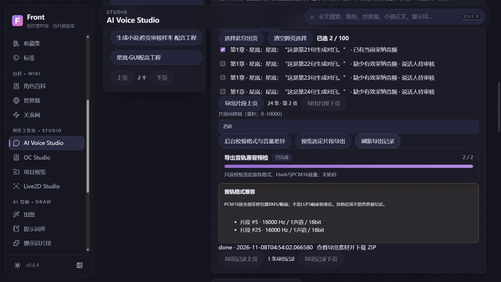

# 配音导出：跨页选择与兼容预检 · 2026-11-08

本增量复用 VoiceExport/Segment/Render、Asset、版本、备份与共享有限队列；无新表/字段、转码器或推理依赖。实现范围是有界选段导出，尚非整本自动制作或可恢复分片拼接。

## 可用流程

打开导出面板才加载独立分页片段列表，每页20、API最多100。按章节序号筛选，明确选择的UID/版本在翻页、切换章节时保留；最多100条/20万字符。工程发生编辑后重新选择，提交前同时核对工程和每个选定片段身份/版本，避免整数ID复用及陈旧选项。原有按工程顺序导出接口兼容，不改动源排序。

可配置片段间0–10000毫秒停顿，导出文件插入新静音帧，不改原音频；8bit无符号PCM使用128中点静音。停顿按采样率取整，计入128MiB总PCM限额与字幕/来源清单；不生成尾部停顿。相对于已合并#58的基线，0保留原默认导出指纹与清单结构。

显式“后台校验格式与音量差异”在既有有限队列运行：先复制到自有临时目录校验身份/Hash，再检查PCM、截断、采样率/声道/位深与总量。PCM16逐块计算所有采样的峰值/RMS及整轨静音；超过6dB差异提示试听，不做LUFS标准化或自动调整。其他位深只报告格式，不冒充已测音量。超过总量停止后续文件读取，标记未检查；有未检查/错误时不提供虚假的完整时长。预检前后复核工程，期间改稿会拒绝旧报告。

实际导出仍独立重新验证，不把预检作为永久通行证。只有所有选段已人工审核且采纳当前音频、格式一致才生成ZIP。取消、失败、中断和新键重试保留已有成品；通用队列在runner前取消的导出显示终态。活动任务有限轮询，关闭面板/离开页清理计时器。

## 真实执行与测试类别

- 本机实际浏览器使用完全生成的三章27片段，第一章24条。选第一页首条和第二页第21条，切换章节后仍显示已选2条；250ms停顿、后台兼容报告、预览及ZIP导出成功。
- 生成协议音1.5秒与手动正弦波2秒拼接为60000帧/16kHz/3.75秒；中间4000帧为0，原始两段PCM字节保持一致。
- ZIP CRC、SRT/VTT起止1.750→3.750秒、来源ID/帧区间、合同与seed42记录均核对通过；不是逐字对齐，也未重新执行TTS。
- 390×844实际文档宽380，无横向溢出，控制台无warn/error。截图仅有生成内容。
- GUI先在独立源码副本执行，再核对两个后端实现和Vue面板的SHA与集成分支一致；集成源码重启后重新校验四条TTS候选、已采纳项、导出成品及原个人DB/WAL/SHM Hash保持。没有把生成协议结果当作真实推理。
- 生成27条的小样本分页：20项响应4350字节，首次45.35ms、5次热请求中位18.76ms。此为同机短样本，不是10万规模、冷启动、整机资源或稳定性能结论。没有为此新增索引。
- 自动回归覆盖章节/跨页/ID版本隔离、停顿帧/字幕与8bit静音、限额/严格参数、格式/RMS差异、缺失文件、预检中改稿及队列前取消；最终全量结果与CI/head见NEXT_SESSION/本PR。
- 集成分支本机474项后端全量、15项前端与生产构建通过；远程CI仍须核对本PR最终head，不将本机通过替代Windows门槛。

## 未完成范围

仍需可恢复分片拼接/章节制作清单、跨重启的选择草稿、受控FFmpeg MP3、更多格式转换、混音与声音质量验收；当前失败只能保留旧成品、明确新请求重试，不声称可从半个PCM继续。参考授权资料库、参考文本/QC、数据集分组/切片/校对、独立训练环境仍按PRD推进。没有下载权重、调用收费API、使用人声或修改用户原始项目。
