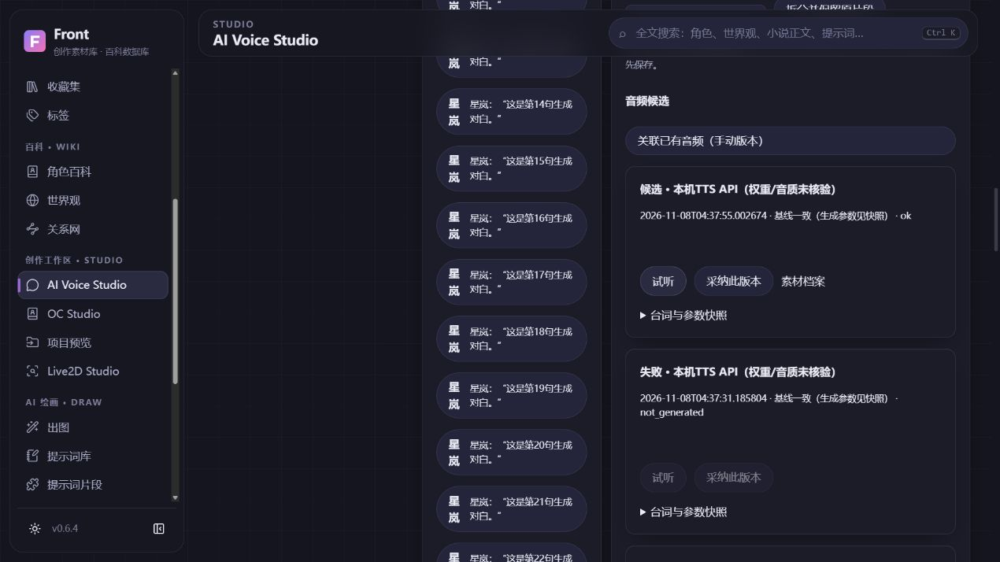
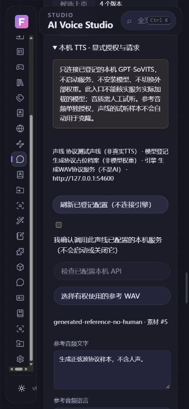

# 受控本机 TTS 接入验收 · 2026-11-08

基线 main `d998c08a6ee334f8a35a0eb604418bfacc21a477`，独立分支 `codex/local-tts-controlled`。没有发现可直接用于真实验收且已确认版本/声音使用权的外部服务，没有启动、关闭或修改用户引擎。

## 实现与兼容

默认关闭的 Front API 与懒加载面板复用现有 VoiceRender、Asset、AudioPlayer 和有限 jobs；无新表/字段、推理依赖或默认服务。只有显式选定参考素材、来源和权限、模型使用权与本机调用确认后才允许排队。端点限字面回环根路径，拒绝 DNS/远程/凭据/重定向。只读协议检查不声称核验实际权重/引擎版本。

在任务内有界复制并校验参考 WAV/Hash/身份/世界观，暂存只在 Front 隔离目录；输出经过完整 PCM 与大小校验后入共享素材。请求使用持久幂等、参数/引用快照、取消/错误/重启保留；先前候选不受失败影响。导出来源清单保留实际 seed/参数/合同/参考版本及未核验标记，不包含本机引擎 URL/模型路径。

## 实际执行证据

| 类别 | 执行与结果 | 局限 |
| --- | --- | --- |
| 自动回归 | 本机全量460后端通过；随后补导出实际参数断言，38项本机协议/API定向回归通过；15前端与生产构建通过 | 最终CI/head以本PR Actions为准 |
| 真实回环HTTP | 自有 Python 协议服务，固定 OpenAPI/tts；正常1.5秒16kHz单声道PCM正弦波 | 无AI、模型或人声 |
| 浏览器正常流程 | 人工改稿保持；声线切换到协议档案；明确参考素材、来源与四项确认；检查、预览、排队、试听、采纳成功 | 不是原生Voice完整交互 |
| 参考隔离 | 请求只发送所选参考的Hash，和声线试听样本Hash不同；原参考Hash不变 | 不是声音许可法律认证 |
| 取消/失败/重试 | 慢HTTP响应取消，HTTP400显示稳定错误，新预览/新键恢复；历史为candidate/error/cancelled/accepted四条 | 客户端取消不保证服务端停止 |
| 重启 | 四条状态、seed45/44/43/42、已采纳音频、参数及引用保留 | 非干净安装/升级测试 |
| 小说回归 | 三章27片段，3确认/24待确认、27来源区间、人工稿与两个历史v1候选均保持 | 未执行AI语义归因 |
| 窄屏与退出 | 390×844下文档宽380，无横向溢出；控制台无warn/error；离开Voice后audio元素0 | 不是长时Heap/GPU泄漏证明 |
| 原始个人库 | 最终只读重核DB/WAL/SHM，与初始取证Hash一致；原始小说/模型未改 | 未替用户升级个人库 |

公开截图只有生成文字/元数据，不含原始用户声音、小说、私有路径清单或模型：

## 性能与待验收

首页入口包仍约216.48kB（构建产物测量），TTS面板单独chunk；未打开不创建HTTP客户端、播放器或跟踪轮询。只活动任务轮询，卸载清理；模型不加载，重任务受共享2worker/32队列与输入输出限额约束。没有把包体积当作TTI/RSS/GPU测量；真实模型推理、长时资源、网络中断实际服务和许可均未验收。

完整原生Voice GUI、干净Windows安装升级、实际GPT-SoVITS权重和音质、MP3/整章分批导出、参考质量/数据集及训练继续保留；本PR不是完整声音克隆或有声制作系统。设置步骤见 [LOCAL_TTS_SETUP](../../LOCAL_TTS_SETUP.md)。
