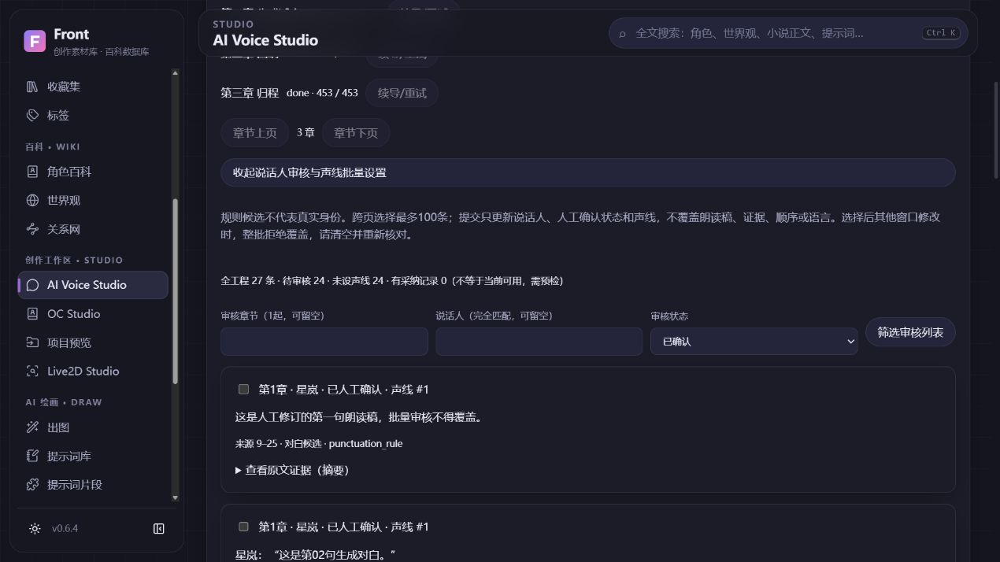
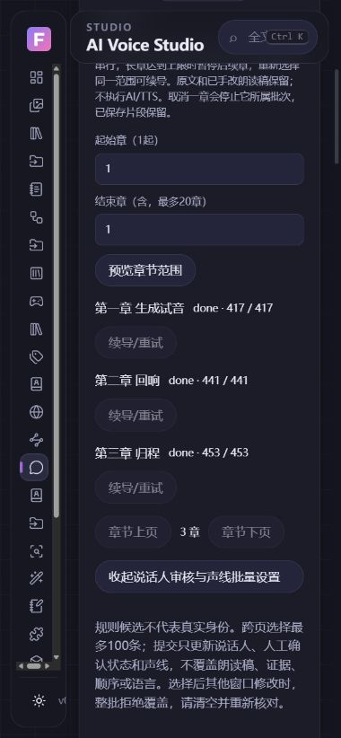

# 小说批量朗读稿与审核 · 2026-11-08

基于 PR #55 合并后的 `aa43ee14dc0988d65697182506e2d6cc2aed5c51`；只用隔离生成小说、虚构人物与 PCM 测试音，不调用 TTS/AI。

## 完成范围

- 从已确认 ChapterRevision 建立原文只读的独立工程。范围预览/确认每批连续至多 20 章，使用既有 VoiceChapterImport 游标、稳定片段身份和共享 2 worker + 32 等待队列。单批一个任务，章内仍至多 10 万字符/1000 片段，不自动无限续导。
- 同工程活动导入串行，避免两个章节并发追加而交错。长章到限额时保留 partial 游标，后续章 waiting；用户重新确认同一范围续导。已完成章节不重复，已有片段/人工改稿/排序不重写。取消本批保留已提交结果，队列失败、通用队列在 runner 前取消、服务中断均可显式续导。
- 分页说话人审核，章节/完全匹配姓名/待审核筛选，跨页选择至多 100 条；原文证据摘要、Unicode 区间及完整来源章节入口。候选姓名不是确认身份；未知/空姓名不能标为已确认。
- 批量设置说话人/声线/确认状态时同时校验工程 uid/版本及每片 uid/版本、作品与世界观范围。全部校验后在同事务写入；任何一条异常整批拒绝。朗读稿、原文证据、语言、速度和排序不被批量覆盖。每批新选择重置上批的设置开关和确认勾选。
- 全工程待审核/缺声线/有采纳记录计数。显式预检已保存的至多 100 片段：声线/模型/本地路径/语言/引擎登记与当前采纳音频；不联系引擎、不创建合成任务，configuration_ready 不代表运行兼容、许可或音质验证。

## 合成指纹与历史兼容

新 v2 指纹只使用文本、有效语言/速度/参数、稳定声线/模型/Provider 身份及登记的合成配置。显示说话人、收藏、评分、标签、标题、备注和授权说明仍有版本记录，但不使音频过期。声线试听样本是试听用途，不是声音克隆输入；其缺失仍在档案诊断显示，不让无关的已生成音频过期。真正的参考克隆输入需以后独立的授权校验。

有效 voice_key、默认语言（未被片段覆盖时）、模型登记路径/版本、Provider 引擎/地址/凭据引用变化会使相关音频过期。只登记模型不读取权重，不能检测未登记的权重原地替换，也不声称已确认引擎实际加载的模型。

旧 v1 候选不批量重写。先校验原指纹，再读取所引用不可变 VersionBlob/EntityVersion、身份与 generation，推导原合成配置。只有可验证且与当前等价时继续试听、采纳及导出；历史缺失、损坏、身份变化则保守过期。原候选快照和完整版本出处保持不变。旧客户端可能把 v2 候选显示为过期，不应降级处理新工程；完成的旧导出保留原文件。

## 实际验收与性能边界

本机 Windows + 生产构建 + IAB Chromium：在页面创建生成小说工程，预览并确认三章，生成 27 个唯一片段；顺序与 27 个原文区间均经独立 API 校验。先手改首段朗读稿，再跨 20 条审核分页选择第 1/21 段、批量确认和绑定声线；之后追加一个独立审核，共 3 确认/24 待审核。重复导入及重启服务后数量、审核、人工稿、原文证据和原小说均保留。配置预检明确显示未配引擎，没有执行 AI/TTS。2 个真实旧格式的手动候选在偏好变更后仍当前有效且未改快照。

审核页面最多 20 条，实测这份样本的响应为 9719 字节；不是长篇/十万条性能验收。当前页和范围状态在活动任务期间 2 秒轮询，离开组件清理计时器；不使用此工作区不加载审核组件。范围提交只查询所选/活动导入记录，状态轮询不 SELECT 小说全文；没有新索引、数据库字段、常驻引擎或依赖。

最终本机全量 433 项后端、15 前端测试及生产构建通过；远程完整组合以本 PR CI 为准。首次并行构建/测试恰遇 Vite 清理 dist 导致两个测试夹具错误，改为先构建再测试。后续一次全量暴露既有 Windows 压力工具 taskkill /T 失败（432通过/1失败）：已改为实际解释器+原导入路径、核对管道中 worker PID 等于 Popen 持有的进程，再只通过该句柄强制结束，无进程名/父PID遍历；8 条中断恢复及无重放继续验证。一次性生成 worker 也有超时自退，最终全量通过。此前两类失败均保留为证据，不归为真实推理或个人库故障。

实际 390×844 检查 document clientWidth/scrollWidth 均为 380，桌面/窄屏无文档横向溢出，检查控制台无未捕获错误。

两图仅为虚构角色、生成小说和程序 UI。

## 原生补充与未完成

从 PR #55 Windows CI 42441276117 取回内部便携包，独立校验 manifest/SHA256/CRC。构建源 `8075e37c6aa6a74a998dcce64945339af9f53c22` 为 GitHub 测试合并提交，父提交确认为 main90b17e9 与 PR55 head d6fa6d1。程序在另一独立生成 DB 正常进入总览；原生交互因最小化/焦点控制限制未计通过。仅结束核对路径的自有外壳，1 秒后的检查显示外壳及所属端口均关闭，其他服务未停止。不是干净安装或完整原生 Voice 验收。

进程采样还发现旧 profiler 只按 parent PID，会把 PID 复用前更早建立的无关子树误算进去；本次未经校正的总量不作性能结论，将独立修复。未覆盖真实 TTS、授权声音、硬件/完整内存、MP3、全章自动音频成片、精确对齐、克隆/训练和干净系统升级。原始个人数据库、小说、模型与 WebUI 均未改动。
