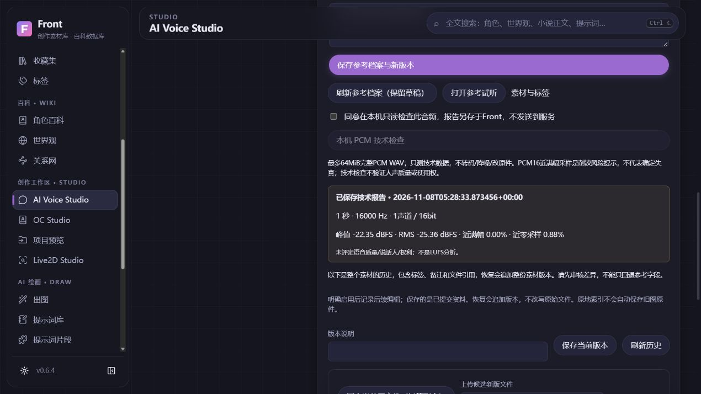
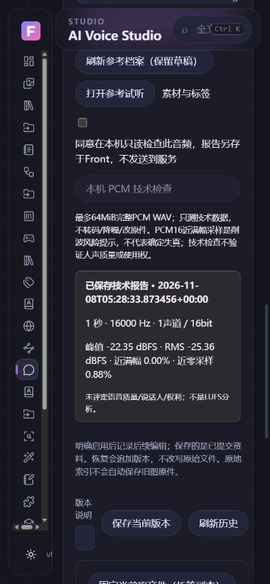

# 参考音频档案与PCM检查验收 · 2026-11-08

基于已合并 #59 的main `5ebb0c7e4d82b743afffe38854f3bad529603127`，独立分支codex/voice-reference-records。没有使用人声、用户私人素材、真实模型、GPU或训练环境；没有新表/字段、权重和推理依赖。

## 自动与数据兼容

本机490项后端全量、15项前端测试和生产构建通过；最终CI/head以本PR为准。新增参考用途/权限严格校验、稳定声线/世界观、资产元数据保留与并发、PCM16/8bit能力差异、缺失/取消/编辑中分析保护、未知未来格式保护、追加版本恢复和完整备份独立恢复。协议测试使用生成WAV/HTTPX，训练许可不能开启零样本请求，撤回后不入库；不是实际模型推理。

测试暴露终态job与旧ORM读取交错时可能缺少最新错误原因；序列化仅刷新已提交的终态记录，不写库或重放任务，通用队列前取消仍正确显示。之前#58修复的成功job不被误判失败保持。没有借诊断自动更改用户数据。

## 实际浏览器与生成文件

1. 从素材库选择既有生成正弦波，填写参考类型、人工文本、来源、许可、声线及独立用途声明；没有复制原件或启动服务。
2. 不完整声明422被拒绝，草稿保留。独立客户端更新备注后，旧页面连续保存409；刷新保留原草稿/并发版本。手动还原草稿后刷新采用新备注，没有覆盖另一客户端资料。
3. 明确本机分析后保存报告：1秒/16kHz/单声道/PCM16，峰值-22.35dBFS、RMS-25.36dBFS、近满幅0、近零0.88%。报告仅技术统计，不是人声/音质/许可结论。
4. 复用AudioPlayer，实际播放时paused=false、duration=1；切换工作区audio元素0。
5. 390px初测文档宽435，定位为列表搜索框/网格最小宽度，修复后文档380。生产构建和真实窄屏复验通过。预期422/409明确反馈；重启后的正常流程控制台无warn/error。
6. 自有实例重启后，声线关联、用途/文本/新备注、报告和四个素材版本保留。原参考WAV Hash不变。
7. 同一生成库通过API完成完整备份、恢复前Hash预览和独立恢复；恢复库integrity=ok/外键0，参考与QC元数据、媒体Hash保持，活动素材记录完全不变。没有恢复覆盖个人库。
8. 复核既有三章27片段、原文区间/人工稿、两个旧v1候选、四条协议候选及3.75秒导出均保留；个人原DB/WAL/SHM再次Hash一致。

公开截图只有生成资料：

## 性能和未完成

列表仅投影ID/标题/日期/类型，每页20、API≤100；不返回长许可、正文或音频。报告扫描仅在显式任务中执行，64KiB复制/8192帧分析，复用2worker/32队列，无默认引擎/摄像头/麦克风。入口包仍约216.48kB，参考编辑器独立chunk；未把构建大小视为整机/RSS/TTI测试。

多参考预设、声音数据集、自动切片/转写、训练验证分组、外部训练环境/资源预算、模型微调、真实声音质量与授权仍未完成。当前类型“训练资料”只是登记，不能当作训练系统。完整原生GUI、长时资源、干净Windows安装升级、正式签名/Release等门槛继续保留。
